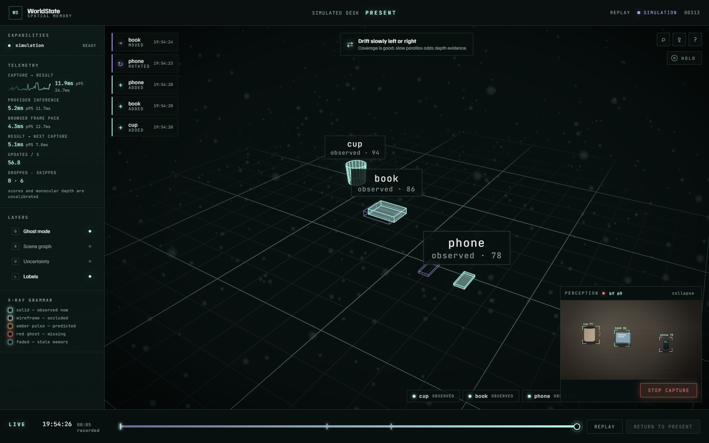
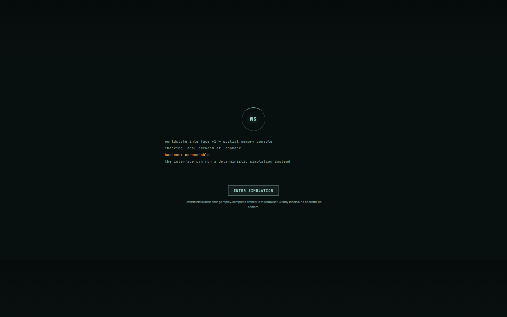
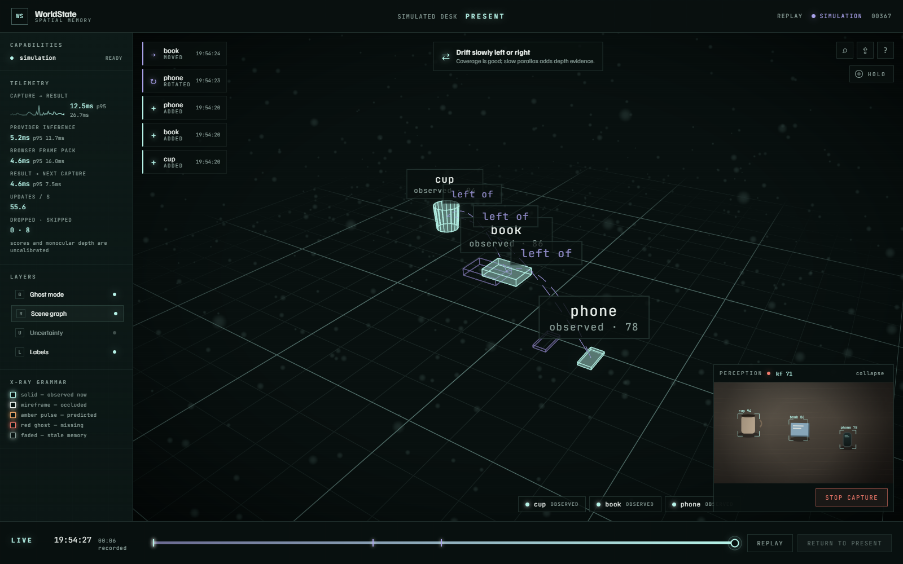
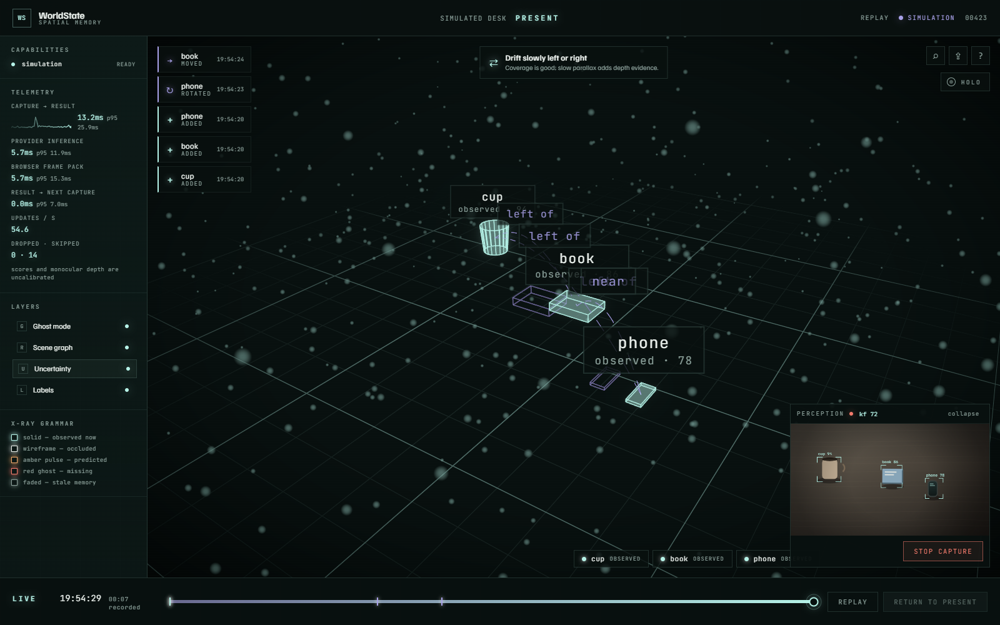
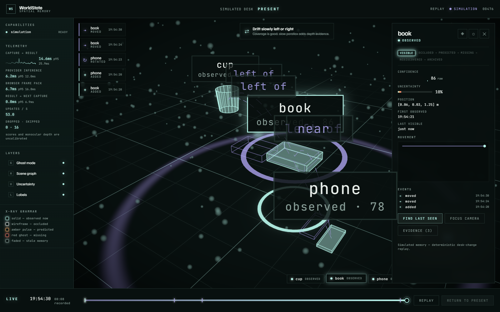
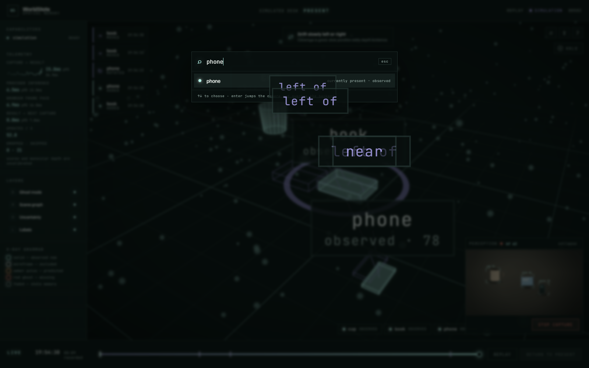
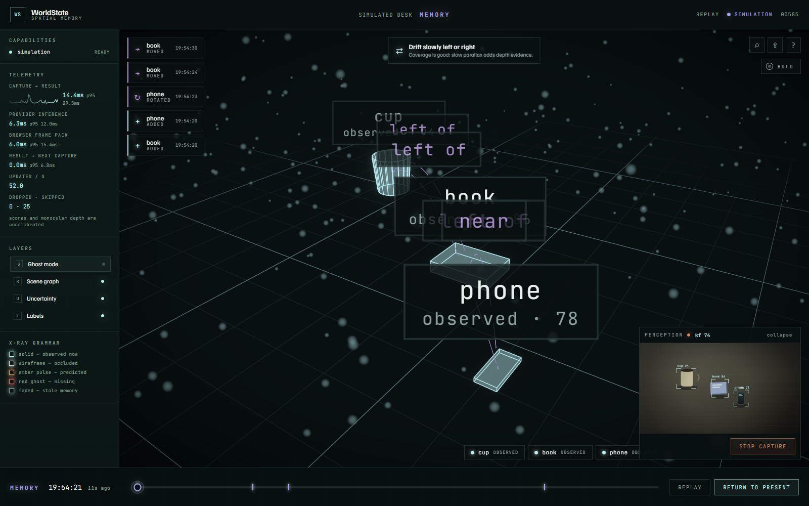

# WorldState

**A persistent visual memory for physical spaces.**

WorldState is a local-first spatial-computing system that turns ordinary webcam
and phone video into a persistent, queryable model of a physical workspace. It
separates static geometry, movable objects, transient agents, and historical
memory so it can explain what exists, what changed, how certain it is, and which
observations support that conclusion.



> The interface above is running WorldState's isolated deterministic desk-change
> simulation. It is clearly labeled `SIMULATION`, uses no camera or backend, and
> is not presented as learned-model output.

The backend is implemented end to end: secure local sessions, versioned REST
and WebSocket contracts, replay and OpenCV providers, temporal memory,
content-addressed persistence, bounded jobs, uploaded-video reconstruction,
evaluation, export, WSL launchers, and explicit pinned model acquisition.
The visual and interaction layer lives under `apps/web/**`.

Replay and classical modes are usable without CUDA. The learned-model and
two-view reconstruction paths are verified locally on the target RTX 4060
Laptop GPU; current measurements and their exact scope live in
[Measured status](docs/MEASURED_STATUS.md). Dataset accuracy targets remain
unclaimed until the private Desk Change Set is captured and evaluated.

The learned live path uses asynchronous Grounding DINO/SAM/DINOv2/depth
correction with per-frame optical-flow propagation and browser-side overlay
prediction. Live display and inference are decoupled from 750 ms durable history
checkpoints, so temporal memory does not stall the camera view.

## What the system demonstrates

- **Persistent object memory:** current state, historical observations,
  confidence, uncertainty, movement trails, evidence, and lifecycle events.
- **Temporal reasoning:** added, moved, rotated, occluded, missing, and
  rediscovered events remain available through the Time Scrubber and Ghost Mode.
- **Inspectable spatial state:** the memory volume, scene graph, uncertainty
  layer, object dossiers, evidence drawer, and Last-Seen Search expose why the
  system believes something.
- **Strict source boundaries:** live webcam, backend replay, and browser-only
  simulation remain visibly and structurally distinct.
- **Local-first operation:** loopback networking, authenticated bootstrap,
  bounded capture, no continuous video retention, and no persistent biometric
  identity.

## Visual walkthrough

### Start without a camera or backend

The browser-only simulation is an explicit entry path, not a hidden fallback.
It exercises the interface with deterministic desk-change data while preserving
the same temporal-memory concepts.



### Inspect relationships and uncertainty

| Scene graph | Uncertainty view |
| --- | --- |
|  |  |

### Open an object's memory

Selecting an entity opens its lifecycle, confidence trace, uncertainty,
position, observation times, movement trail, recent events, and evidence count.



### Search what the workspace remembers

Last-Seen Search distinguishes an object that is currently present from one that
was only observed in the past, then focuses the corresponding spatial record.



### Move through remembered time

The Time Scrubber reconstructs earlier state without mutating live memory.
Ghost Mode and event ticks make prior observations and changes visible.



## Product direction

- Live webcam memory for a desk or workspace.
- Optional multi-view reconstruction from ordinary RGB video.
- Added, moved, removed, occluded, and rediscovered object events.
- Ghost Mode, Time Scrubber, Change Pulses, Object Memory, Uncertainty View,
  animated Scene Graph, and Last-Seen Search.
- Active Scan Coach for uncertainty-guided capture.
- HoloConsole for deliberate two-hand spatial interaction.
- Local evidence, provenance, and research-grade evaluation.

Read the complete [product specification](product_spec.md).

## Repository map

```text
apps/web/                    React and Three.js spatial interface
services/api/                FastAPI coordinator
packages/worldstate-core/    Framework-independent domain and provider ports
packages/contracts/          Generated OpenAPI, protocol schemas, TS, replay
configs/                     Versioned product and experiment configuration
datasets/                    Dataset manifests; private captures are ignored
docs/                        Architecture, privacy, design, and decisions
experiments/                 Reproducible experiment entrypoints and results
native/                      Future measured C++/CUDA optimization
paper/                       Technical-report source and reproduction notes
scripts/                     Bootstrap, development, and verification commands
```

## Prerequisites

- Windows 11
- Node.js 22 or newer
- pnpm 10
- uv
- Python 3.12, installed automatically by the bootstrap script when possible
- Ubuntu 24.04 under WSL2 for the supported learned-model runtime

CUDA models are deliberately not downloaded during bootstrap.

## Bootstrap

```powershell
powershell -ExecutionPolicy Bypass -File .\scripts\bootstrap.ps1
```

## Develop

Start the API:

```powershell
powershell -ExecutionPolicy Bypass -File .\scripts\dev-api.ps1
```

Start the interface in another terminal:

```powershell
powershell -ExecutionPolicy Bypass -File .\scripts\dev-web.ps1
```

Open `http://127.0.0.1:5173`.

The API bootstrap is capability-protected. For the production same-origin
launcher, follow [Operations](docs/OPERATIONS.md).

## Verify

```powershell
powershell -ExecutionPolicy Bypass -File .\scripts\verify.ps1
```

The default verification path is model-free and suitable for CI. GPU
feasibility, model access, latency, VRAM, and accuracy are separate measured
gates. Reproduce the hardware gates with `scripts/gpu-smoke.py`,
`scripts/production-smoke.py`, and `scripts/live-soak.py` inside the supported
local environment.

Useful references:

- [Claude frontend handoff](docs/CLAUDE_FRONTEND_HANDOFF.md)
- [API and live protocol](docs/API_PROTOCOL.md)
- [Model inventory](docs/MODELS.md)
- [Threat model](docs/worldstate-threat-model.md)
- [Research protocol](docs/RESEARCH.md)
- [Measured engineering report](paper/ENGINEERING_REPORT.md)
- [Portfolio demo script](docs/DEMO_SCRIPT.md)

## Privacy boundary

WorldState binds locally by default, does not persist continuous webcam video,
does not create persistent biometric identities, and does not infer sensitive
personal traits from appearance. See [Privacy](docs/PRIVACY.md) and the
[threat model](docs/THREAT_MODEL.md).

## License

Original source is licensed under Apache-2.0. Model weights, datasets, fonts, and
other third-party artifacts retain their own licenses and are not covered by
the project license.
