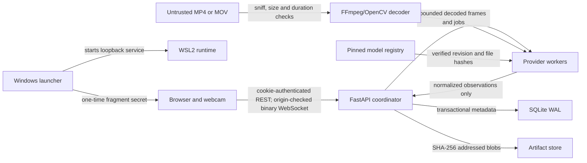

# WorldState threat model

Status: implementation review, protocol v1
Scope: single-user local application on Windows 11 and Ubuntu 24.04 under WSL2
Last reviewed: 2026-07-30

## System and assumptions

WorldState receives webcam frames or an explicitly uploaded MP4/MOV, derives
object observations and geometry locally, and stores an append-only temporal
scene model. The browser is not trusted merely because it runs on the same
machine. The API binds only to loopback. There is no LAN listener, cloud
inference, telemetry, remote account, or multi-user authorization model.

The operator controls the Windows and WSL accounts. A fully compromised local
administrator, kernel, browser profile, or GPU driver is out of scope. Public
hosting, phone live streaming, and mutually untrusted local users require a new
model before implementation.

## Protected assets

| Asset | Why it matters |
| --- | --- |
| Webcam frames, uploaded video, masks | May reveal the operator, possessions, documents, and home layout |
| Scene graph, object history, last-seen data | Reveals routines and spatial state even without raw video |
| Geometry and calibration | Can reconstruct a private physical space |
| Embeddings and model intermediates | May encode appearance and must not become biometric templates |
| Launcher/session/CSRF secrets | Grant control of the local API |
| Artifact and database integrity | Determines whether WorldState reports real observations or fabricated state |
| Model files and Python packages | Execute inside high-privilege local inference processes |
| Experiment provenance | Supports every technical and performance claim |

## Trust boundaries and data flows

### Boundary 1: browser to localhost API

Inputs are untrusted JSON, multipart bodies, cookies, origins, WebSocket control
messages, and binary image envelopes. Controls include loopback binding,
TrustedHost, exact HTTP/WebSocket origin validation, one-time bootstrap,
HttpOnly SameSite cookies, CSRF headers, strict Pydantic models, body/frame
limits, monotonic sequences, timestamp windows, and security headers.

### Boundary 2: Windows launcher to WSL2

The launcher builds the static frontend, starts the pinned WSL environment, and
opens a URL containing a one-time secret in the fragment. Fragments do not
reach HTTP logs. The frontend must exchange it immediately, call
`history.replaceState`, and never place it in local storage, telemetry, or an
error report.

### Boundary 3: uploaded media to decoder

Container signatures, declared media type, byte limit, decoded duration,
dimensions, keyframe count, and decoder runtime are bounded. Filenames are
ignored for storage. Input is stored under an opaque content hash outside the
web root. Decoder crashes must fail only the owning job.

### Boundary 4: API to inference workers

The API event loop never runs heavy inference. Workers receive bounded frames,
normalized prompts, and opaque IDs. The GPU scheduler prevents an offline scan
from sharing an 8 GB device with a live session; it suspends the persistent live
worker before the reconstruction process starts. Live and reconstruction
workers are independently supervised. Cancellation terminates the owning
reconstruction process, and worker failures produce explicit persistent job
states.

### Boundary 5: worker to artifact store

Workers cannot choose public paths. The store validates its fixed SHA-256 key
grammar, resolves paths under one root, writes atomically, verifies reads, and
enforces the 75 GB quota. Ownership edges are stored transactionally and scene
deletion decrements references before verified garbage collection.

### Boundary 6: model registry to loader

The committed manifest allowlists sources, licenses, immutable revisions, and
relative locations. Acquisition is an explicit CLI action. The generated local
lock records every file hash. Runtime loaders reject absent, modified, moving,
or path-escaping entries and never download implicitly. Fast capability
inventory checks only the locked file set; the actual loader boundary performs
the full SHA-256 verification. The browser-local hand model is served only from
that verified registry.

## Threat scenarios and mitigations

| ID | Scenario | Impact | Implemented controls | Residual risk |
| --- | --- | --- | --- | --- |
| T1 | Malicious site calls localhost API | Camera/scene theft or mutation | exact origin, cookie, CSRF, TrustedHost, no wildcard CORS | compromised allowed origin can act as the operator |
| T2 | Bootstrap token leaks via URL logging | session takeover | fragment, one-time exchange, no query token, no server log, history removal contract | browser extensions can inspect tabs |
| T3 | WebSocket flood or stale replay | CPU/RAM exhaustion or false history | authenticated handshake, 64 KB control cap, frame cap, monotonic sequence, 30-minute time window, one frame acknowledged at a time | one local authenticated tab can consume its bounded share |
| T4 | Oversized or malformed image | decoder crash or decompression bomb | encoded byte/dimension bounds, color decode check, header/payload agreement | native decoder vulnerabilities depend on patched OpenCV |
| T5 | Malicious video container | code execution or denial of service | type sniff, byte/duration limits, timeouts, job isolation, pinned dependencies | FFmpeg/OpenCV remain a high-value native attack surface |
| T6 | Path traversal through artifact ID or filename | arbitrary read/write | opaque UUIDs, ignored filenames, strict storage-key regex, resolved-root containment | local database tampering is out of scope |
| T7 | Disk exhaustion | system instability/data loss | 75 GB logical quota, pre-write checks, bounded uploads, orphan GC, diagnostics | concurrent external writes to the repository volume can consume free space |
| T8 | GPU/RAM exhaustion | crash or unusable machine | exclusive scheduler, bounded jobs, adaptive model cadence, live-worker suspension, cancellable reconstruction process, resolution/keyframe fallback | new providers and larger inputs require the hardware gate to be repeated |
| T9 | Poisoned or replaced model | arbitrary code/false results | source allowlist, immutable revision, SHA-256 lock, local-only load, safetensors where available | SAM checkpoint uses trusted pickle-compatible Torch format |
| T10 | Sensitive-trait prompts | harmful inference or scope drift | server-side prompt policy, ordinary-object allow boundary, transient people/hands, no biometric persistence | generic models may still encode demographic information internally |
| T11 | Absolute paths or secrets in errors | local information leak | public schemas, opaque IDs, generic worker errors, request IDs, no frame/embedding logs | third-party tracebacks remain visible to the local developer console |
| T12 | Scene deletion leaves private blobs | privacy failure | artifact ownership table, FK cascades, ref-count decrement, immediate verified GC, deletion tests | separately exported files copied by the operator are outside lifecycle control |
| T13 | Forged model/event confidence | misleading user or research claim | raw scores labeled uncalibrated, evidence/provenance, held-out calibration requirement, measured-report policy | user can still misinterpret approximate geometry |
| T14 | Production documentation exposes mutation UI | expands attack surface | docs and OpenAPI routes disabled in production | generated contract artifact remains intentionally public in the repository |

## Security requirements for future changes

- LAN access, hosted APIs, phone streaming, cloud sync, user accounts, or remote
  model calls require a new threat review.
- A new model must include code/weight license, immutable revision, file hashes,
  deserialization format, network behavior, and resource profile.
- A new persisted artifact type must have an ownership edge, deletion test, and
  quota accounting.
- A new WebSocket message must remain a strict discriminated union and include
  malformed, replay, flood, and authorization tests.
- Camera frames, embeddings, secrets, absolute paths, and private dataset rows
  must never enter structured logs or Git.

## Verification evidence

The CPU suite covers hostile origins, missing CSRF/session state, unknown
fields, stale/duplicate frame sequences, invalid image/container signatures,
artifact size and integrity mismatches, traversal-resistant storage keys,
queue saturation, cancellation, worker errors, crash recovery, model tampering,
scene deletion, and unauthenticated WebSockets. GPU OOM behavior, decoder
timeouts on adversarial media, 30-minute soak stability, and complete model
smokes remain local hardware gates and must not be represented as passing until
their dated reports exist.
